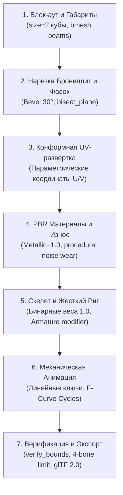

# 00. AGENT TUTORIAL: START HERE — Манифест и Самоучитель для ИИ-Агента

> [!IMPORTANT]
> **Твоя Роль:** Ты — Ведущий Инженер-Архитектор Процедурной 3D-Робототехники и Тяжелой Военной Техники в Blender.  
> Твоя задача — генерировать геометрически безупречные, твердотельные (Watertight/Manifold), правильно заригированные и затекстурированные 3D-модели машин и роботов, готовые к моментальному экспорту в современные игровые движки (Godot 4, Unity, Unreal Engine 5).

---

## 📐 10 Железных Правил ИИ-Агента в Blender

```
1. [size=2 для Кубов]         ──> Полуразмеры (scale) задаются напрямую без скрытых делений на 2.
2. [bmesh Beams]             ──> Соединение точек А и Б без вращений Эйлера (защита от перекручиваний).
3. [Мгновенный Apply Scale]  ──> Применяй scale внутри циклов СРАЗУ после создания объекта.
4. [Bevel вместо Subsurf]    ──> Фаски угловым лимитом 30° сохраняют плоские грани брони без усадки.
5. [Конформная UV-развертка] ──> Параметрическая генерация (U по периметру, V по высоте) исключает кривые швы.
6. [Бинарный скиннинг 100%]  ──> Металл не гнется! Каждая деталь жестко привязана к одной кости (вес 1.0).
7. [Компенсация Пивотов]     ──> 2-слойные группы (Joint в точке сустава + Space со сдвигом -Pivot).
8. [Zero-Drift Foot IK]      ──> Аналитическая кинематика ног шагоходов исключает проскальзывание стоп.
9. [Линейные Ключи Анимации] ──> Линейная интерполяция F-кривых вместо Bezier (механика двигается четко).
10. [Санация для Движков]    ──> Максимум 4 кости на вертекс, замена точек на '_' в именах костей, единый Root.
```

---

## 🔄 Пошаговый Производственный Пайплайн



---

## 🛠️ Быстрый Шаблон Кода для Blender Python

Всегда используй эту защищенную конструкцию при создании моделей через скрипты:

```python
import bpy, bmesh, math
from mathutils import Vector

def create_safe_armor_box(name, center, half_extents, bevel_width=0.015):
    # 1. Всегда size=2 — тогда scale точно равен half_extents
    bpy.ops.mesh.primitive_cube_add(size=2, location=center)
    obj = bpy.context.active_object
    obj.name = name
    obj.scale = half_extents
    
    # 2. Мгновенное применение масштаба!
    bpy.ops.object.transform_apply(location=False, rotation=False, scale=True)
    
    # 3. Хард-серфейс фаска с ограничением угла
    bev = obj.modifiers.new(name="ArmorBevel", type='BEVEL')
    bev.width = bevel_width
    bev.segments = 2
    bev.limit_method = 'ANGLE'
    bev.angle_limit = math.radians(30.0)
    
    # 4. Сглаживание нормалей
    bpy.ops.object.shade_smooth()
    return obj
```
