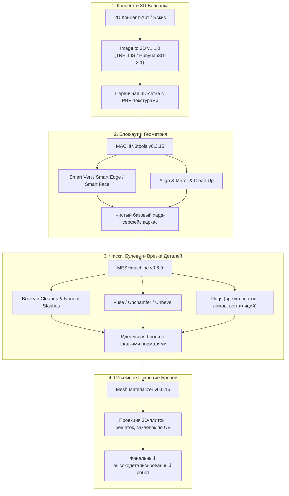

# Карта Аддонов и Инструментария для Создания Роботов и Техники (Hard-Surface & Mech Addon Ecosystem)

> **Анализ архивов из папки:** `I:\1_VSCODE\2026_3  GAMES\ROBOt2_5d\ROBO_FACTORY\АДДОНЫ\ADDONS2\`
> 
> Полный генеральный каталог всех 35+ аддонов проекта с кодом вызова: **[`MASTER_ADDON_ECOSYSTEM_CATALOG.md`](./MASTER_ADDON_ECOSYSTEM_CATALOG.md)**.
> 
> В данном руководстве разобран профессиональный стек из 4 ключевых аддонов (ADDONS2), покрывающий базовый цикл создания боевых мехов, роботов и военной техники.

---

## 🗺️ Генеральная Карта Пайплайна: Где и Какой Аддон Применять

---

## 🔬 Детальный Разбор Каждого Аддона

---

### 1. `Image to 3D` (v1.1.0) — Локальный Нейросетевой 3D-Генератор
- **Автор:** Milad Kambari (3DRedbox Studio)
- **Версия Blender:** 4.2.0+ (современный формат расширений)
- **Где находится в Blender:** `3D Viewport > Боковая панель (N) > Image to 3D`
- **Движки под капотом:**
  - **TRELLIS.2** (Microsoft) — сверхбыстрая генерация геометрии из одного изображения.
  - **Hunyuan3D 2.1** (Tencent: `hy3dshape` + `hy3dpaint`) — генерация высококачественной формы и PBR-текстурирование на базе RomanTex и MaterialMVP.
  - **MoGe** — глубокая оценка нормалей и карты глубин (DINOv2).

#### Чем полезен для роботов и техники:
1. **Мгновенный 3D Блок-аут (Zero-to-Mesh):** Вы загружаете 2D-арт робота, боевой машины или концепта оружия, и аддон прямо на вашей локальной видеокарте (NVIDIA 10GB+ VRAM) за 1–3 минуты генерирует цельную объемную 3D-модель (`.glb`) с базовыми текстурами.
2. **Никаких подписок и облаков:** Генерация происходит локально, без траты кредитов Midjourney/Tripo3D/Meshy.
3. **Идеальная болванка под ретопологию:** Полученная сетка служит точным объёмным шаблоном для сборки твердотельной модели по правилам хард-серфейса.

---

### 2. `MACHIN3tools` (v0.3.15) — Швейцарский Нож Хард-Серфейс Моделирования
- **Автор:** MACHIN3
- **Версия Blender:** 2.83+ / 3.x / 4.x
- **Горячие клавиши:** `Tab` (Modes Pie), `Z` (Shading Pie), меню в Edit Mode, боковая панель.

#### Ключевые инструменты и их применение:
- **`Smart Vert` (Умные вершины):**
  - Слияние вершин в последнюю, в центр или в 3D-курсор одним кликом.
  - Скольжение и продление ребер до пересечения (Slide Extend / Path Connect) — незаменимо при сведении сложных скосов бронелистов.
- **`Smart Edge` (Умные ребра):**
  - Мгновенный поворот ребер (Spin Edge), переключение весов фасок (Bevel Weight), выделение замкнутых контуров.
- **`Smart Face` (Умные грани):**
  - Мостовое соединение (Bridge), заполнение квадами (Grid Fill), правильный Inset для панелей люков.
- **`Clean Up` (1-клик очистка сетки):**
  - Мгновенно удаляет дубликаты вершин, растворяет бесполезные компланарные ребра, пересчитывает вывернутые нормали наружу и вычищает висячие точки после тяжелых булевых операций.
- **`Align` (Пространственное выравнивание):**
  - Прецизионное выравнивание деталей робота друг относительно друга по осям X/Y/Z, подгонка к полу (Floor Snap), центрирование по активному объекту.
- **`Mirror / Unmirror`:**
  - Быстрая настройка симметричного модификатора для конечностей робота (руки, ноги, парные орудия).
- **`Focus`:**
  - Умная изоляция выбранной детали (люка, поршня) со скрытием остального гигантского робота и мгновенным возвратом назад.

#### Чем полезен:
Увеличивает скорость моделирования роботов в **3–5 раз**. Избавляет от сотен рутинных нажатий горячих клавиш при сведении вершин и полигонов.

---

### 3. `MESHmachine` (v0.6.9) — Высший Пилотаж Фасок, Булевых и Врезки Деталей
- **Автор:** MACHIN3
- **Версия Blender:** 2.80+ / 2.93 / 3.x
- **Горячая клавиша:** Клавиша `Y` в Object Mode и Edit Mode.

> [!IMPORTANT]
> **Это главный аддон в индустрии для хард-серфейса без сабсёрфа!** Он решает фундаментальную проблему Blender: как редактировать фаски и булевы швы, когда они уже применены в полигоны (destructive modeling).

#### Ключевые возможности для робототехники:
1. **`Unchamfer` и `Unbevel` (Обратимость фасок):**
   - Вы можете взять фаску на бронеплите, которую сделали три дня назад, нажать `Unbevel` — и она **мгновенно превратится обратно в острый угол 90°**!
2. **`Fuse` и `Refuse`:**
   - Превращает плоскую односегментную фаску (Chamfer) в скругленный желоб или выпуклый валик нужного радиуса с гибким контролем натяжения и профиля.
3. **`Boolean Cleanup`:**
   - После булевого вычитания цилиндра из наклонной брони образуется «вершинный ад». `Boolean Cleanup` автоматически стягивает микроребра, удаляет скользящие артефакты и готовит чистую полосу под фаску.
4. **`Normal Stashes` и `Normal Flatten` (Устранение затенений и грязи):**
   - Сохраняет нормали гладкой изогнутой детали *до* булева выреза, а после выреза переносит их обратно. В результате вокруг вырезанных отверстий и орудийных портов **полностью исчезают темные пятна и растянутые тени**.
5. **Система Плагов (`Plugs` — Врезка Готовых Узлов):**
   - Позволяет брать готовые высокодетализированные 3D-узлы (лючки, вентиляционные решетки, розетки кабелей, болтовые фланцы) и **в один клик «впечатывать» их в искривленную броню**. Аддон сам вырезает отверстие в базовом меше, сшивает топологию и переносит нормали.

---

### 4. `Mesh Materializer` (v0.0.16) — Геометрическое Текстурирование по UV
- **Автор:** Mark Kingsnorth
- **Версия Blender:** 2.82+ / 3.x
- **Где находится:** `3D Viewport > Панель Mesh Materializer`

#### В чем концепция:
Обычные материалы накладывают на UV-развертку 2D-картинку (пиксели).  
`Mesh Materializer` берет **реальную 3D-геометрию** (отдельный меш-паттерн) и «рисует» или проецирует её на поверхность целевого объекта, ориентируясь по его UV-координатам и нормалям граней!

#### Чем полезен для роботов и техники:
1. **Реактивная броня и плитки:**
   - Моделируется одна плитка композитной брони. Аддон раскладывает сотни таких плиток по сложной изогнутой башне танка или корпусу меха строго по UV-сетке.
2. **Радиаторы и теплообменники:**
   - Раскладка тонких охлаждающих ребер по поверхности реактора или двигателя.
3. **Заклепочные и болтовые ряды:**
   - Нанесение тысяч болтов вдоль стыков броневых листов без ручной расстановки.
4. **Металлические сетки и грили:**
   - Обтягивание вентиляционных отверстий настоящей объемной проволочной сеткой или гексагональными сотами.

---

### 5. `zForm` (v2.4.3) — 2.5D Displacement, Рельефы и ShadowBox
- **Автор:** Viz Life Studio (Blender 3.6.0+)
- **Путь к архиву:** `E:\PROGRAMS 2020\3 D PROGRAMS\BLENDER MODEL\ADDONS\ADDONS new\zform_2.4.3.zip`
- **Роль:** Мгновенное выдавливание барельефов, эмблем фракций и блочного силуэта деталей методом **ShadowBox** (по силуэтным маскам).

---

### 6. `smoothWeights` (v3.0) — Профессиональный Скиннинг от Brave Rabbit
- **Автор:** Ingo Clemens (Brave Rabbit)
- **Путь к архиву:** `E:\PROGRAMS 2020\3 D PROGRAMS\BLENDER MODEL\ADDONS\ADDONS new\smoothWeights v3.0.zip`
- **Роль:** Прецизионное лапласовское сглаживание весов вершин на подвижных суставах, гофрах и шарнирах с гарантированным сохранением нормализации $1.0$ (без потери объема и утечки весов на далекие кости).

---

## 🛠️ Сводная Таблица и Синергия Аддонов

| Аддон | Роль в проекте робота | Что дает инженеру/агенту | Ключевая фишка |
| :--- | :--- | :--- | :--- |
| **Image to 3D (v1.1.8)** | Генерация формы из арта | Старт с готовой 3D-модели за 2 минуты | Локальный TRELLIS.2 / Hunyuan на GPU |
| **zForm (v2.4.3)** | 2.5D рельефы и ShadowBox | Выдавливание эмблем, знаков и силуэтов | Генерация сетки из карт глубин |
| **MACHIN3tools** | Моделирование и сборка | Скорость работы x3, идеальное выравнивание | `Smart Vert`, `Clean Up`, `Align` |
| **MESHmachine** | Прецизионная броня и швы | Фаски без грязи, откат фасок, врезка плагов | `Y Menu`, `Fuse`, `Unbevel`, `Plugs` |
| **Mesh Materializer**| Физическая детализация | Миллионы болтов, решеток и плиток по UV | Геометрический 3D-материал |
| **smoothWeights (v3.0)** | Скиннинг и развесовка | Идеальные сгибы суставов без заломов | Сохранение весов 1.0, Symmetry Map |

---

## 💡 Практический Сценарий: Как создать боевого робота с этой связкой

1. **Генерация базы:** Берем арт робота $\to$ прогоняем через **`Image to 3D`** $\to$ получаем 3D-габаритную болванку.
2. **Чистка и блок-аут:** Включаем **`MACHIN3tools`**, нажимаем `Clean Up` $\to$ выравниваем суставы через `Align` $\to$ нарезаем симметрию через `Mirror`.
3. **Хард-серфейс доводка:** Нажимаем `Y` (**`MESHmachine`**) $\to$ делаем булевы вырезы под сопла и кабину $\to$ лечим стыки через `Boolean Cleanup` $\to$ врезаем готовые вентиляционные порты через `Plugs`. Если фаска не подошла — откатываем её через `Unbevel`.
4. **Обшивка броней:** Запускаем **`Mesh Materializer`** $\to$ покрываем наклонные плоскости регулярными плитками динамической брони и рядами заклепок по UV.
5. **Экспорт:** Прогоняем веса через модификаторы нашей академии `ROBO_BLENDER_ACADEMY` и отдаем модель в Godot 4 / Unreal Engine 5.

