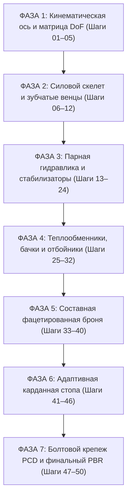

# МАСТЕРКЛАСС: ПРОЕКТИРОВАНИЕ И МОДЕЛИРОВАНИЕ НОГИ БОЕВОГО МЕХА В BLENDER
## Полное руководство от примитивного блокаута (1-2%) до промышленного Hard-Surface CAD мастер-уровня (100%)

---

## ВВЕДЕНИЕ: В ЧЕМ РАЗНИЦА МЕЖДУ НОВИЧКОМ И МАСТЕРОМ?

### «Ловушка мыльного гроба» (Новичок, 1-2%):
- **Симптомы**: Бедро моделируется как цельный цилиндр или вытянутый прямоугольник со скруглением. Суставы — плоские круглые шайбы («овалы»). Стопа — плоская монолитная плита («доска»). Один тонкий поршень висит в воздухе.
- **Главная ошибка**: Восприятие механизма как сплошной скульптуры. Попытка нарисовать наружную форму без понимания того, **как эта нога передает тонны нагрузки, где сжимается масло и куда отводится тепло**.

### «Архитектурный CAD-подход» (Мастер, 100%):
- **Принцип**: Любой узел боевого шагохода состоит из **4 независимых функциональных слоев**, работающих в гармонии:
  1. **Слой 1: Несущий силовой скелет (Chassis & Pivots)** — двутавры, поворотные цапфы, зубчатые венцы, шпиндели.
  2. **Слой 2: Приводы и кинематика (Kinematics & Actuation)** — парные гидроцилиндры, зеркальные штоки, шаровые наконечники, гибкие бронешланги.
  3. **Слой 3: Вспомогательные системы (Subsystems & Thermal)** — ребристые радиаторы, бачки гидроаккумуляторов, пакеты тарельчатых пружин (отбойники хода), клеммные коробки датчиков.
  4. **Слой 4: Накладная фацетированная броня (Segmented Armor & Cowlings)** — раздельные щиты с фасками и окнами технологического обзора, сквозь которые видна работа механизмов.

---

## АНАТОМИЧЕСКИЙ АНАЛИЗ: ДО И ПОСЛЕ

| Узел | ❌ ДО: Примитив (Фото 3) | ✅ ПОСЛЕ: Промышленный CAD (Фото 1 и 2) | Физический смысл и почему это работает |
| :--- | :--- | :--- | :--- |
| **Тазобедренный узел (Hip)** | Одиночный гладкий цилиндр с шестигранником на торце. | Двухопорная вилка с боковыми крышками подшипников, стопорными пластинами и верхней балкой. | Равномерно распределяет крутящий момент шасси без выламывания оси. |
| **Главный привод колена** | Один тонкий шток в центре, не способный удержать массу робота. | **Сдвоенные параллельные гидроцилиндры** с массивными проушинами, хромированными штоками и сальниками. | Параллелограммная схема исключает перекос сустава при боковых ударных нагрузках. |
| **Охлаждение и теплообмен** | Отсутствует. Гладкие пустые коробки. | **Радиаторный блок с продольными жалюзи (louvers)** на коленной плите + спаренные бачки-аккумуляторы на бедре. | Отвод тепла от циркулирующего масла гидросистемы высокого давления. |
| **Коленный сустав** | Простой плоский срез цилиндра. | Трапециевидная коробка с угловыми косынками жесткости, упорами хода и защитным козырьком. | Защищает шток цилиндра от встречных осколков и пуль при движении вперед. |
| **Голеностоп (Ankle)** | Жесткая Т-образная спайка. | **Карданно-сферический шарнир (Gimbal)** с массивным поворотным кольцом и шаровым пальцем. | Дает стопе 2 степени свободы: крен (roll) и тангаж (pitch) при ходьбе по камням и склонам. |
| **Опорная стопа (Foot)** | 2–3 плоских параллельных бруска с нулевым клиренсом. | **4-сегментный независимый аутригер (лапы)** с арочным мостом (клиренс $85\text{ мм}$), шарнирами пальцев и резиновыми башмаками. | Каждая лапа адаптируется к углу рельефа независимо, предотвращая опрокидывание многотонной машины. |

---

## 7 ЭТАПОВ СОЗДАНИЯ: ПОШАГОВЫЙ ТОТАЛЬНЫЙ ПЛАН (50 ШАГОВ)

---

### ФАЗА 1: КИНЕМАТИЧЕСКАЯ ОСЬ И МАТРИЦА СТЕПЕНЕЙ СВОБОДЫ (Шаги 01–05)
1. **Калибровка пропорций**: Высота ноги $H = 3.65\text{ м}$, глубина шага $D = 1.95\text{ м}$, ширина колеи $W = 0.85\text{ м}$.
2. **Фиксация центров вращения (Pivots)**:
   - Тазобедренный шарнир: $(0.0, 0.67, 3.24)\text{ м}$
   - Коленный шарнир: $(0.0, 0.06, 1.86)\text{ м}$
   - Голеностопный шарнир: $(0.0, -0.22, 0.53)\text{ м}$
3. **Разбивка на 4 слоя**: Цветовое кодирование объемов (ID map) перед моделированием.

---

### ФАЗА 2: СИЛОВОЙ РОТАЦИОННЫЙ СКЕЛЕТ (Шаги 06–12)
1. **Зубчатый венец колена (Sunburst Gear Hub)**:
   - Создание базового диска ступицы $\varnothing 0.52\text{ м}$.
   - Вытягивание 24 радиальных зубьев трапециевидного сечения с фасками $45^\circ$.
   - Внутренний ступенчатый карман для снижения массы (pocketing) глубиной $35\text{ мм}$.
   - Центральный стальной шпиндель $\varnothing 0.16\text{ м}$ со стопорной гайкой.
2. **Сегментированный кабелеукладчик (Cable Chute)**:
   - Построение трехмерной дуги Bezier между бедром и тазом.
   - Массив из 14 шарнирных звеньев коробчатого сечения с перекрытием $15\%$.

---

### ФАЗА 3: ПАРНАЯ ГИДРАВЛИКА И ПРИВОДЫ (Шаги 13–24)
1. **Парные цилиндры привода**:
   - Диаметр гильзы: $2 \times \varnothing 0.11\text{ м}$ (вместо одного центрального).
   - Зеркальные штоки: высокополированный хром, шероховатость $0.05$.
   - Верхний монолитный блок крепления с поперечным шарнирным пальцем.
2. **Голеностопные стабилизаторы**:
   - Два диагональных амортизатора на шарнирных головках с пыльниками.

---

### ФАЗА 4: ТЕПЛООБМЕН, БАЧКИ И ПОДСИСТЕМЫ (Шаги 25–32)
1. **Оребренные аккумуляторы (Accumulator Canisters)**:
   - Сдвоенные цилиндры высокого давления на верхнем фланце бедра.
   - Кольцевые радиаторные ребра с шагом $12\text{ мм}$ для рассеивания тепла.
2. **Радиаторный блок голени**:
   - Фрезерованная панель с 12 вертикальными щелевыми ребрами (Louvers).
3. **Узел отбоя хода (Travel-Stop Damper)**:
   - Пакет тарельчатых пружин Бельвиля со стальной пяткой-наковальней.

---

### ФАЗА 5: СОСТАВНАЯ НАКЛАДНАЯ БРОНЯ (Шаги 33–40)
1. **Отказ от сплошного «гроба»**:
   - Броня бедра разбивается на верхний фацетированный щит, боковые щеки и лобовой козырек.
   - Между щитами создаются **технологические зазоры (Reveal Gaps)** $8–15\text{ мм}$.
2. **Коленное смотровое окно**:
   - Вырез в броне, сквозь который зритель видит сжатие и блеск хромированных штоков гидроцилиндров.
3. **Фаски (Bevels)**:
   - Жесткие грани скалываются фасками шириной $4–8\text{ мм}$ с весовым нормалями (Weighted Normals) для красивого металлического блика без артефактов.

---

### ФАЗА 6: АДАПТИВНАЯ КАРДАННАЯ СТОПА (Шаги 41–46)
1. **Карданное кольцо (Gimbal Ring)**:
   - Массивное торообразное кольцо с боковыми цапфами, обеспечивающее наклон влево/вправо.
2. **Шаровой палец (Ball Joint)**:
   - Сферическая опора центральной стойки голени.
3. **4 шарнирные лапы (Claws)**:
   - 2 передние лапы под углом $\pm 22^\circ$, 2 задние пятки под углом $\pm 155^\circ$.
   - Нижний арочный свод: просвет над землей не менее $80\text{ мм}$.
   - Шарнирные пальцы крепления лап с фиксаторами.
   - Рифленые резиновые накладки на пятне контакта с грунтом.

---

### ФАЗА 7: КРЕПЕЖ PCD И ФИНАЛЬНЫЙ СТУДИЙНЫЙ СВЕТ (Шаги 47–50)
1. **Болтовые круги (PCD — Pitch Circle Diameter)**:
   - Размещение болтов M10/M16 по окружности ступиц с шагом $30^\circ$ или $45^\circ$.
2. **Материалы PBR**:
   - Основная броня: полуматовый промышленный титан/композит (Roughness $0.35$).
   - Внутреннее шасси: темная оружейная сталь (Gunmetal, Metallic $1.0$, Roughness $0.5$).
   - Штоки гидравлики: полированный хром (Metallic $1.0$, Roughness $0.05$).
   - Резиновые башмаки: диэлектрик (Roughness $0.85$, черная резина с микрорельефом).

---

## БИБЛИОТЕКА ГОТОВЫХ СКРИПТОВ И НАВЫКОВ

Все скрипты сохранены и доступны для автоматического применения:

### 1. Каталог постоянного навыка Antigravity:
`C:\Users\blizz\.gemini\config\skills\mech-hardsurface-components\`

### 2. Репозиторий проекта:
[`ROBO_FACTORY/SKILLS_HARDSURFACE_COMPONENTS/`](file:///I:/1_VSCODE/2026_3%20%20GAMES/ROBOt2_5d/ROBO_FACTORY/SKILLS_HARDSURFACE_COMPONENTS/)

| Скрипт генератора | Назначение в макете |
| :--- | :--- |
| `build_sunburst_gear.py` | Генерация радиальных зубчатых венцов с выборками облегчения и шпинделями |
| `build_bolt_pattern.py` | Автоматическая круговая PCD-разметка болтов, шпилек и шестигранных гаек |
| `build_cable_chute.py` | Построение сегментированных бронекабелеукладчиков вдоль 3D-кривых |
| `build_finned_canister_block.py` | Создание H-образных радиаторных блоков со сдвоенными оребренными бачками |
| `build_articulated_foot.py` | Сборка 4-палой карданной стопы с арочным клиренсом и подвеской |

---

## ЭТАЛОННАЯ 3D-СЦЕНА
- **Изолированная эталонная нога (53 детали)**:  
  [`REFERENCE_LEG_ISOLATED.blend`](file:///I:/1_VSCODE/2026_3%20%20GAMES/ROBOt2_5d/ROBO_FACTORY/LEG_STUDY_LAB/REFERENCE_LEG_ISOLATED.blend)
- **Итоговая процедурная мастер-сборка**:  
  [`MASTER_LEG_50_STEPS_COMPLETE.blend`](file:///I:/1_VSCODE/2026_3%20%20GAMES/ROBOt2_5d/ROBO_FACTORY/LEG_STUDY_LAB/MASTER_LEG_50_STEPS_COMPLETE.blend)

